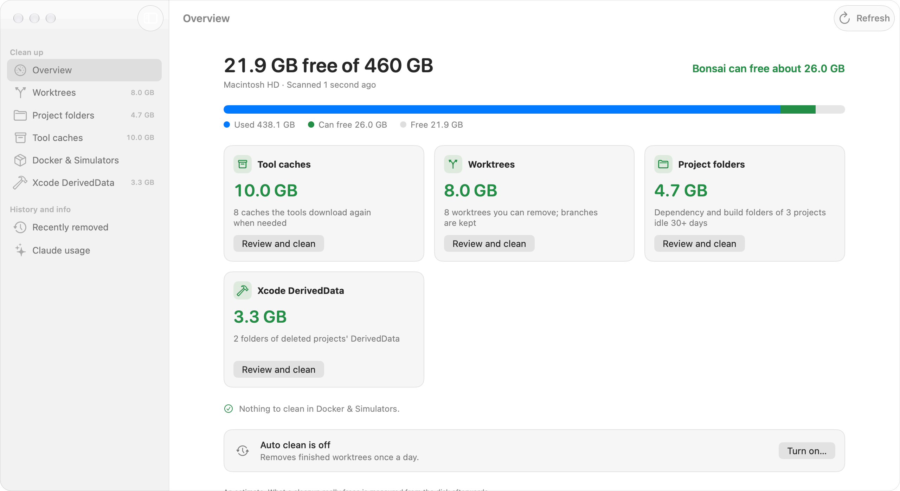
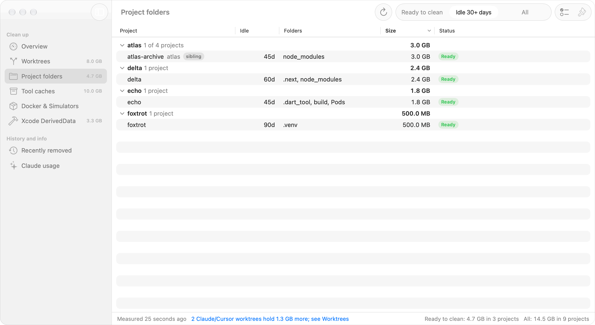
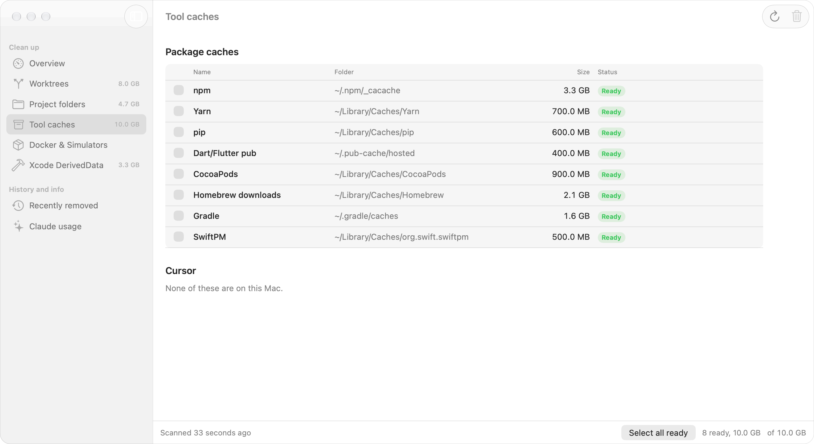
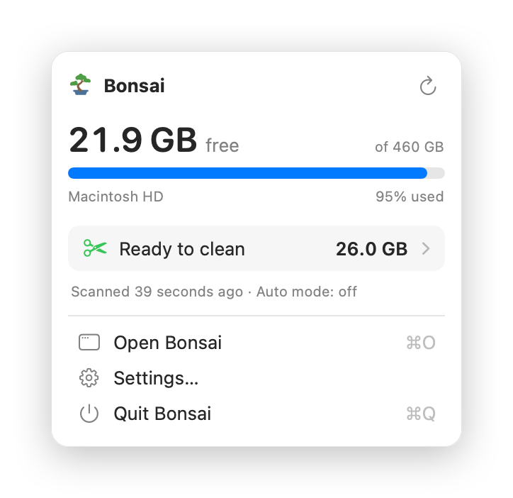
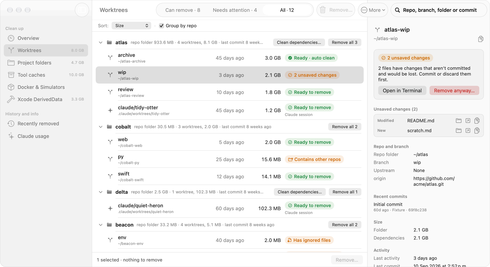
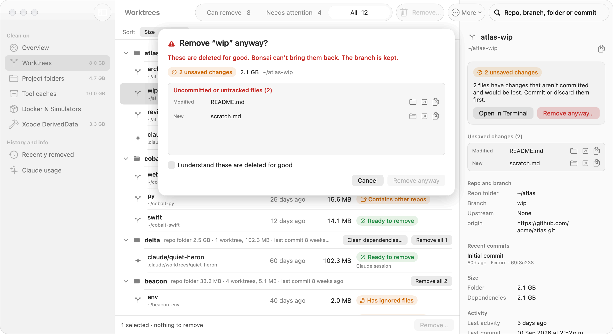

<p align="center">
  
</p>

<h1 align="center">Bonsai</h1>

<p align="center">
  <b>Get back the gigabytes your dev tools leave behind. Safely.</b><br>
  A Mac menu-bar app for people with too many worktrees, node_modules and caches.
</p>

<p align="center">
  <a href="https://github.com/brauliovc1/bonsai/releases/latest"><b>Download for Mac</b></a>
  &nbsp;·&nbsp; macOS 14 or later &nbsp;·&nbsp; Apple silicon and Intel &nbsp;·&nbsp; Free and open source
</p>

```bash
brew install --cask brauliovc1/tap/bonsai
```

<p align="center"><sub>Bonsai isn't signed by Apple yet, so the Homebrew install clears macOS's download flag for it.</sub></p>

<picture>
  <source media="(prefers-color-scheme: dark)" srcset="docs/images/overview-dark.png">
  
</picture>

## One look. Everything you can free.

Bonsai finds what's taking your space, tells you what's safe to delete, and cleans it with one click.

<table>
  <tr>
    <td width="50%"><b>Worktrees</b><br>Extra checkouts of your repos, including the ones Claude and Cursor create. See which are finished and remove them. Your branches stay.</td>
    <td width="50%"><b>Project folders</b><br><code>node_modules</code>, <code>.next</code>, <code>build</code> and friends in projects you haven't touched in weeks.</td>
  </tr>
  <tr>
    <td><b>Tool caches</b><br>npm, Yarn, pip, CocoaPods, Gradle, Homebrew, SwiftPM and more, plus old Cursor data.</td>
    <td><b>Docker and Simulators</b><br>Stopped containers, dangling images and unused build cache (never volumes), plus simulators Xcode can't use anymore.</td>
  </tr>
  <tr>
    <td><b>Xcode DerivedData</b><br>Build data of projects that no longer exist.</td>
    <td><b>In your menu bar</b><br>Free space at a glance, and how much is ready to clean.</td>
  </tr>
</table>

<table>
  <tr>
    <td width="38%">
      <picture>
        <source media="(prefers-color-scheme: dark)" srcset="docs/images/project-folders-dark.png">
        
      </picture>
    </td>
    <td width="38%">
      <picture>
        <source media="(prefers-color-scheme: dark)" srcset="docs/images/tool-caches-dark.png">
        
      </picture>
    </td>
    <td width="24%">
      <picture>
        <source media="(prefers-color-scheme: dark)" srcset="docs/images/menu-dark.png">
        
      </picture>
    </td>
  </tr>
</table>

## Worktrees, sorted out

Every worktree, grouped by repo, with its size, when you last worked in it, and whether it can go.

<picture>
  <source media="(prefers-color-scheme: dark)" srcset="docs/images/worktrees-dark.png">
  
</picture>

## Safe by design

- **Checks before every delete.** Unsaved changes, unpushed commits, open apps: Bonsai looks again right before it deletes, and stops if anything changed.
- **Your branches stay.** Removing a worktree never deletes its branch, so you can bring it back from Recently removed.
- **You see the cost first.** If a worktree holds unsaved work and you remove it anyway, Bonsai lists every file you'd lose first.
- **Everything is logged.** Every cleanup is written down, with what it freed.
- **Nothing leaves your Mac.** Bonsai works offline and sends nothing anywhere.

<picture>
  <source media="(prefers-color-scheme: dark)" srcset="docs/images/remove-anyway-dark.png">
  
</picture>

## Clean up while you sleep

Turn on auto clean and Bonsai removes finished worktrees once a day. The first week it only reports what it would do.

## From the terminal

The same engine, as a command (`make install` adds it, or take `bonsai` from the zip on [Releases](https://github.com/brauliovc1/bonsai/releases/latest)):

```bash
bonsai scan                 # every worktree, with its size and whether it can go
bonsai remove <path>        # remove one the safe way (shows what it would do without --yes)
bonsai projects             # dependency folders in your projects
bonsai caches               # package-manager caches
```

<details>
<summary><b>All commands</b></summary>

| Command | What it does |
|---|---|
| `bonsai compare main HEAD` | Review changes since the merge base, ahead/behind counts and merge conflicts |
| `bonsai scan` | List every worktree with its repo, branch, size, idle days and status |
| `bonsai remove` | Remove worktrees the safe way (branches are kept) |
| `bonsai restore` | Put a removed worktree back from its kept branch |
| `bonsai prune` | Clear git's records of worktrees whose folders are gone |
| `bonsai light-clean` | Delete a worktree's dependency and build folders |
| `bonsai projects` | Dependency and build folders across your checkouts |
| `bonsai caches` | Package-manager caches and Cursor data |
| `bonsai derived-data` | Xcode DerivedData, and orphaned folders to delete |
| `bonsai docker` | Where Docker's space goes, and prune |
| `bonsai simulators` | Simulator disk use, and delete unavailable ones |
| `bonsai claude-usage` | Space taken by Claude's transcripts and versions (read-only) |
| `bonsai auto` | What auto clean would do, with reasons |
| `bonsai log` | Every cleanup Bonsai has done |
| `bonsai settings` | The settings the app and the command share |

Every command that deletes only prints what it would do until you add `--yes`. `bonsai <command> --help` has the details.
</details>

<details>
<summary><b>Other ways to install</b></summary>

**Download.** Get the `.dmg` from [Releases](https://github.com/brauliovc1/bonsai/releases/latest), open it, and drag Bonsai to Applications. The first time, macOS blocks it: open **System Settings › Privacy & Security**, find Bonsai near the bottom, and click **Open Anyway**.

**The command only.** Unzip `bonsai-<version>-macos.zip` from the same page and put `bonsai` on your `PATH` (if macOS blocks it: `xattr -d com.apple.quarantine bonsai`).

**Build from source** (Xcode 16 or later):

```bash
git clone https://github.com/brauliovc1/bonsai.git
cd bonsai
make install
```
</details>

<details>
<summary><b>Good to know</b></summary>

- Sizes are estimates; what a cleanup frees is measured afterwards and can be a little lower.
- The first scan of your Documents folder asks for macOS's permission once.
- Time Machine's local snapshots can keep deleted data for a while.
- Docker cleanup works with Docker Desktop (not OrbStack or colima).
- Remove anyway looks at the worktree again a moment before git deletes it; a file written in that last moment isn't in the list.
- Bonsai keeps its settings and log in `~/Library/Application Support/Bonsai`.
- Bonsai was called clean-claude until November 2026: `make install` keeps a `clean-claude` command that runs `bonsai`, and Bonsai moves its old settings folder for you.
</details>

## Review branches

Open **Compare** in the Review sidebar group to inspect a branch before opening a pull request. Pick a base and branch, or a worktree to include unsaved and new files. Files show word and syntax highlights, generated files stay collapsed, and the Commits tab reviews one commit at a time. Compare never fetches or changes your repo. Branch reviews include committed submodule version changes. Worktree reviews leave out submodule changes; pick the branch to review its committed versions. Files inside submodules are not compared.

```sh
bonsai compare --repo /path/to/repo main feature --json
```

## What's next

- Cleanups that run in the background while you keep working
- A map of your branches: where each was cut from, and when it was merged

## License

MIT © 2026 Braulio Vargas
